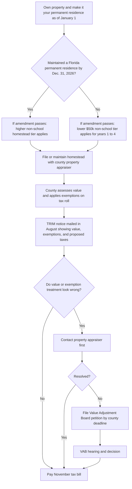
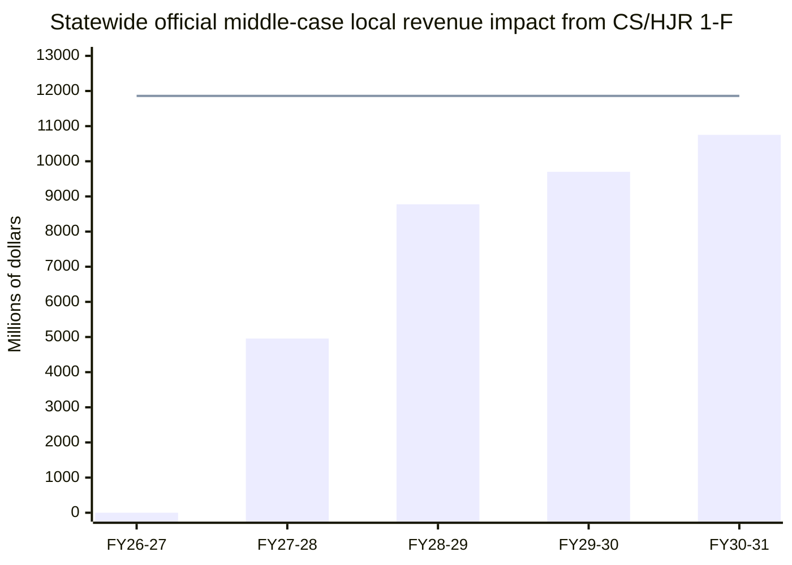

# Florida’s Proposed Property Tax Cut for Homeowners

Florida’s 2026 special-session package branded as the “Property Tax Cut for Florida Homeowners” is not yet an operative tax cut. The core policy was passed as **CS/HJR 1-F**, which places a constitutional amendment on the **November 3, 2026** general-election ballot, alongside the linked implementation bill **CS/SB 4-F**, which was approved by the Governor on **June 24, 2026**. Because this is a constitutional amendment, it needs at least **60% statewide voter approval** to pass. If it passes, the amendment text says it would take effect **January 1, 2027**. citeturn8view0turn11view0turn10view2turn38search0

From a real estate and homeowner standpoint, this is a very big proposal. For Floridians who already maintain a permanent residence in the state by the end of 2026, the measure would sharply expand the **non-school homestead exemption** from today’s roughly **$51,411 maximum non-school benefit structure in 2026** to **$150,000 starting in 2027** and **$250,000 starting in 2028**. It would also cut the annual non-school assessment cap for many non-homestead residential and nonresidential properties from **10% to 5%**. State economists estimate the **middle-case recurring local revenue loss at $11.8612 billion per year**, with the impact falling on **non-school local revenue, not school taxes**. citeturn46view0turn31view0turn45view0turn44view0turn44view1

## Executive summary

The simplest way to understand the proposal is this: it would leave the **school-tax homestead exemption at $25,000**, but dramatically increase how much of a homestead is exempt from **county, municipal, and many special-district ad valorem taxes**. For existing Florida residents, the non-school exemption would rise to **$150,000 in 2027** and **$250,000 in 2028**. For people who establish Florida residency on or after January 1, 2027 **and were not Florida permanent residents as of December 31, 2026**, the amendment would generally limit the non-school exemption to **$50,000** for the first four years, with access to the larger tier beginning in the **fifth year**, unless a county or municipality later shortens that wait for a “critical local need” under the amendment’s local-option language. citeturn46view0turn10view0

That means the proposal is best described as a **large non-school tax cut for current Florida homeowners and long-time Florida residents**, a **smaller-or-delayed benefit for post-2027 newcomers**, and a **meaningful carrying-cost reduction for many non-homestead and business properties** because of the new 5% cap. The fiscal tradeoff is equally large: Florida’s official Revenue Estimating Conference found a **$0 school impact** but a very large **non-school local impact**, including middle-case recurring annual losses of about **$1.0602 billion in Palm Beach County**, **$1.1855 billion in Broward County**, and **$1.4147 billion in Miami-Dade County** once the full recurring effect is on the books. citeturn45view0turn33view0turn33view1turn33view2

One nuance that matters for brokers and tax-savvy buyers: the amendment’s ballot summary uses broad language about “full elimination,” but the **operative constitutional text** does not itself automatically erase all local property taxes on homesteads statewide. Instead, it directly raises the non-school homestead exemption to $150,000 and then $250,000, while also instructing the Legislature to create uniform procedures by which **counties and municipalities** could increase the exemption further for their own levies, and **special districts** could do so by referendum. School taxes remain structurally different, and the state economists’ official estimate shows **no school-tax loss** from this amendment. citeturn10view0turn10view2turn45view0

## What the amendment would actually change

The operative text of **CS/HJR 1-F** does four major things. First, it keeps the **$25,000 homestead exemption for school district levies**. Second, for **all levies other than school district levies**, it raises the homestead exemption for existing Florida residents to **$150,000 beginning January 1, 2027** and **$250,000 beginning January 1, 2028**. Third, it creates a different non-school homestead track for people who did **not** maintain a permanent Florida residence by **December 31, 2026**: those homeowners would receive **$50,000** of non-school exemption for the first four years and then move to the larger exemption tier in year five. Fourth, it lowers the annual non-school assessment cap from **10% to 5%** for many non-homestead residential properties with nine units or fewer and for many other non-homestead real properties, including businesses. citeturn46view0

Under current law, Florida homesteads generally receive a **$25,000 exemption applying to all taxes**, plus an inflation-adjusted **second homestead exemption** that applies only to **non-school taxes** on assessed value above $50,000. The Florida Department of Revenue’s January 2026 bulletin set that additional exemption at **$26,411** for the 2026 tax year, meaning the current-law maximum non-school exemption structure is roughly **$51,411** in total non-school exempt value, although it is split into two pieces rather than one uninterrupted block. Palm Beach County’s property appraiser pages and Miami-Dade’s exemption pages are still describing that current structure today, which is another reminder that the 2026 amendment is still prospective and vote-dependent. citeturn31view0turn35view1turn37view0

The proposal also preserves the existing **Save Our Homes portability** framework. The amendment text retains the constitutional portability language allowing a qualified homeowner moving from one Florida homestead to another to transfer up to **$500,000** of accumulated Save Our Homes benefit, subject to the existing formulas. That matters because many sellers who become buyers again would still be analyzing two separate issues at once: the growing non-school exemption under the amendment, and the continuing ability to carry forward capped-value benefits through portability. citeturn8view0turn35view3

A second nuance is that the proposal does **not** wipe out non-ad valorem assessments such as special benefit assessments and many local fees. The homestead language continues to exempt property from taxation **except assessments for special benefits**, and county estimator pages continue to distinguish **ad valorem** taxes from **non-ad valorem** charges. In practical terms, solid-waste, lighting, drainage, fire, PACE, CDD, or similar assessment lines can still remain on a bill even when the homestead ad valorem portion falls sharply. citeturn46view0turn15search1turn42search5

The final linked bill, **CS/SB 4-F**, is much narrower than the political messaging around the amendment. The bill page and enrolled text show that SB 4-F primarily revises **maximum millage calculations**, related certification mechanics, and authorizes the longer ballot summary. It does **not** itself spell out a detailed parcel-by-parcel implementation code for the new residency split, local-option increases, or a statewide zero-tax schedule for homesteads. The constitutional amendment text, by contrast, explicitly says the **Legislature shall prescribe uniform procedures** for several parts of the program. That means major implementation details still depend on later legislative and administrative follow-through if voters approve the amendment. citeturn11view0turn12view0turn10view0

### Current law compared with the proposal

| Issue | Current law | If amendment passes |
|---|---|---|
| School-tax homestead exemption | $25,000 | $25,000 |
| Non-school homestead exemption for Florida residents already maintaining permanent residence by Dec. 31, 2026 | Current two-part structure; 2026 max additional exemption is $26,411, creating roughly $51,411 of non-school exempt value in total | $150,000 starting Jan. 1, 2027; $250,000 starting Jan. 1, 2028 |
| New resident who was **not** a Florida permanent resident by Dec. 31, 2026 | Current-law homestead structure would otherwise apply | $50,000 non-school exemption for first 4 years; larger tier in year 5, unless locally shortened after 2030 for critical need |
| Non-homestead residential cap | 10% for non-school levies | 5% beginning Jan. 1, 2027 |
| Nonresidential / business cap | 10% for non-school levies | 5% beginning Jan. 1, 2027 |
| School revenue effect in official fiscal estimate | Not applicable | Officially quantified at $0 |
| Local option for more relief | Existing law only | Counties/municipalities may get a uniform statutory path to exempt more for their levies; special districts may do so by referendum |

*Table note:* This summary is drawn from the enrolled constitutional text, the Department of Revenue’s 2026 inflation-adjustment bulletin, and the official Revenue Estimating Conference workbook. citeturn46view0turn31view0turn45view0

## Who qualifies and how implementation would likely work

Eligibility under the amendment turns on **residency timing**, not just ownership. The higher $150,000 and $250,000 non-school tiers are available to a person who has legal or equitable title and maintains the permanent residence of the owner or a dependent there. The lower temporary $50,000 non-school tier is targeted to a person who establishes a homestead on or after January 1, 2027 **and had not maintained a permanent residence in Florida as of December 31, 2026**. That means a long-time Florida renter who buys in 2027 is analytically different from an out-of-state buyer relocating into Florida in 2027. citeturn46view0

The county pages in Palm Beach, Broward, and Miami-Dade still show the **current** filing and review cadence. Palm Beach says failure to apply by **March 1** waives that year’s homestead privilege; Broward’s 2026 homepage says the timely filing window ran through **March 2, 2026** with a late-file deadline of **September 18, 2026**; Miami-Dade says applications must be submitted by **March 1**, with late filing available into the post-TRIM period. Those counties also continue to describe the ordinary TRIM-and-VAB sequence: review the value and exemption treatment when the **TRIM notice** arrives in August, contact the property appraiser first, and then petition the **Value Adjustment Board** if needed. citeturn35view1turn35view0turn37view0turn34search7turn35view4turn35view5

Because the amendment would first become effective on **January 1, 2027** if approved, the likely real-world implementation path is straightforward in broad outline even though not all details have been published yet. Existing homestead owners would likely see the change through 2027 roll coding and 2027 TRIM notices; new applicants would likely still need to establish title, residency, and homestead eligibility through the ordinary county process; and any dispute about residency classification, exemptions, portability, or change-of-ownership effects would continue through the VAB system that Florida DOR already describes for value and exemption appeals. That timing is an inference from the current county filing calendars and Florida’s standing VAB process, not a county-specific 2027 implementation notice. citeturn10view2turn35view0turn35view1turn37view0turn34search7turn43search19

### Figure caption

**Figure 1. Likely assessment and appeal path if the amendment passes.** This flowchart reflects the ordinary Florida homestead and TRIM timeline as described by county property appraisers and VAB guidance, with the amendment’s existing-resident versus new-resident split layered into that process. citeturn35view0turn35view1turn37view0turn34search7turn35view4turn35view5

*Alt text:* A step-by-step process map showing how a homeowner would move from ownership and residency qualification, to homestead filing, to assessment and TRIM notice review, and finally to either payment or a VAB appeal if value or exemption treatment is disputed.

## What the numbers look like

For a publishable apples-to-apples comparison, the most honest way to model this amendment is to hold **assessed value** constant and compare only the **ad valorem** portion of the tax bill. That isolates the constitutional change itself. The tables below therefore use assessed value rather than list price, assume the property is a qualifying homestead, hold millage rates constant at recent official county rates, and **exclude non-ad valorem assessments** and special local exemptions for seniors, veterans, or similar categories. Palm Beach and Miami-Dade also publish enough official material to benchmark median homestead assessed values; Broward’s public-facing tools are less cleanly searchable by median assessed value, so the Broward scenarios below use official millage rates and representative assessed-value tiers rather than a county-published median assessed benchmark. citeturn31view0turn19view2turn18view2turn19view0turn40view0turn39view0turn42search5

The assumptions are intentionally conservative. For Palm Beach, I used countywide and district millage figures shown on the county’s official final millage materials, excluding municipality-specific city millage. For Miami-Dade, I used the official **Municipal Service Area / county representative row** from the 2025 adopted millage chart. For Broward, I used official **Unincorporated code 0012** millage because that yields a full school/non-school split; Broward’s own homebuyer estimator says the countywide average total rate is **19.8394 mills**, which is slightly above the **19.0509 mills** used here, so the Broward examples are conservative. citeturn19view2turn19view0turn18view2turn42search5

### Assumptions used for the scenario calculations

| County | Representative tax environment | School mills | Non-school mills | Total mills |
|---|---|---:|---:|---:|
| Palm Beach | Countywide + county districts; no municipality-specific city millage | 6.3210 | 9.9442 | 16.2652 |
| Broward | Unincorporated representative environment, code 0012 | 6.4845 | 12.5664 | 19.0509 |
| Miami-Dade | Municipal Service Area / county representative environment | 6.6330 | 10.2987 | 16.9317 |

*Table note:* Palm Beach school and district rates come from the official final millage comparison table; Broward’s split comes from the official final millage table for unincorporated code 0012; Miami-Dade’s split comes from the official 2025 adopted millage chart. Author calculations sum the relevant countywide, district, and school components. citeturn19view2turn18view2turn19view0

### How the calculation works

Under current law, the school side still taxes assessed value above **$25,000**. On the non-school side, current law shields a first **$25,000** plus the inflation-adjusted second exemption on value above **$50,000**, which the Department of Revenue set at **$26,411** for 2026. If the amendment passes, an existing Florida resident’s non-school taxable value would instead be assessed value above **$150,000** in 2027 and above **$250,000** in 2028, while school taxes would still generally start above **$25,000**. citeturn31view0turn46view0

### Official-value homeowner examples

| Example | Assessed value | Current-law ad valorem | If approved in 2027 | If approved in 2028 | 2027 savings | 2028 savings |
|---|---:|---:|---:|---:|---:|---:|
| Palm Beach median homestead assessed value, FY 2026 county budget example | $218,781 | $2,889.25 | $1,908.86 | $1,224.89 | $980.39 | $1,664.36 |
| Miami-Dade countywide median homestead assessed value, 2025 preliminary report | $232,099 | $3,234.54 | $2,219.20 | $1,373.69 | $1,015.34 | $1,860.85 |

*Table note:* Palm Beach’s FY 2026 budget workshop lists a **median assessed homestead value of $218,781** and a **median taxable value of $168,059**. Miami-Dade’s 2025 preliminary countywide homestead report lists a **median assessed value of $232,099** and **median taxable value of $177,141**. The ad valorem figures above are author calculations using the county assumptions table and the amendment’s exemption rules. citeturn40view0turn39view0

### Representative scenario table across three counties and three tiers

| County | Property type and tier | Assessed value | Current-law ad valorem | If approved in 2027 | If approved in 2028 | 2028 savings |
|---|---|---:|---:|---:|---:|---:|
| Palm Beach | Condo tier | $250,000 | $3,397.03 | $2,416.64 | $1,422.22 | $1,974.81 |
| Palm Beach | Single-family tier | $500,000 | $7,463.33 | $6,482.94 | $5,488.52 | $1,974.81 |
| Palm Beach | High-value tier | $1,500,000 | $23,728.53 | $22,748.15 | $21,753.72 | $1,974.81 |
| Broward | Condo tier | $250,000 | $3,954.56 | $2,715.65 | $1,459.01 | $2,495.55 |
| Broward | Single-family tier | $500,000 | $8,717.29 | $7,478.38 | $6,219.74 | $2,497.55 |
| Broward | High-value tier | $1,500,000 | $27,768.19 | $26,529.28 | $25,270.64 | $2,497.55 |
| Miami-Dade | Condo tier | $250,000 | $3,537.63 | $2,522.30 | $1,492.43 | $2,045.20 |
| Miami-Dade | Single-family tier | $500,000 | $7,770.56 | $6,755.22 | $5,725.35 | $2,045.21 |
| Miami-Dade | High-value tier | $1,500,000 | $24,702.26 | $23,686.92 | $22,657.05 | $2,045.21 |

*Table note:* These examples assume an existing Florida resident qualifying for the higher non-school exemption track. They exclude non-ad valorem assessments. The savings are driven by official county school/non-school millage assumptions and the enrolled amendment text. citeturn19view2turn18view2turn19view0turn31view0turn46view0

One more practical observation for REALTORS®: the proposal is **not especially generous in years one through four for brand-new Floridians moving from out of state after January 1, 2027**. Using the 2026 inflation-adjusted current-law exemption as a conservative baseline, the amendment’s temporary flat **$50,000 non-school exemption** for those newcomers is only roughly comparable to current law and can even be **slightly less favorable** than today’s structure until the fifth-year step-up, because current law’s total non-school exempt amount is already roughly **$51,411** in 2026. citeturn31view0turn46view0

### Figure caption

**Figure 2. Palm Beach representative ad valorem bill comparison for three homestead tiers.** Existing Florida residents see the biggest drop in 2028, when the non-school exemption reaches $250,000. citeturn19view2turn31view0turn46view0

```mermaid
xychart-beta
    title "Palm Beach representative homestead ad valorem taxes"
    x-axis ["$250k condo","$500k single-family","$1.5M high-value"]
    y-axis "Tax dollars" 0 --> 25000
    bar "Current law" [3397,7463,23729]
    bar "If approved 2027" [2417,6483,22748]
    bar "If approved 2028" [1422,5489,21754]
```

*Alt text:* A grouped bar chart for Palm Beach showing representative ad valorem taxes under current law, in 2027 if the amendment passes, and in 2028 if the amendment passes, for $250,000, $500,000, and $1.5 million assessed homesteads.

### Figure caption

**Figure 3. Broward representative ad valorem bill comparison for three homestead tiers.** This Broward illustration uses a conservative unincorporated representative rate rather than the higher county-average estimator rate. citeturn18view2turn42search5turn31view0turn46view0

```mermaid
xychart-beta
    title "Broward representative homestead ad valorem taxes"
    x-axis ["$250k condo","$500k single-family","$1.5M high-value"]
    y-axis "Tax dollars" 0 --> 30000
    bar "Current law" [3955,8717,27768]
    bar "If approved 2027" [2716,7478,26529]
    bar "If approved 2028" [1459,6220,25271]
```

*Alt text:* A grouped bar chart for Broward showing representative ad valorem taxes under current law, in 2027 if the amendment passes, and in 2028 if the amendment passes, for $250,000, $500,000, and $1.5 million assessed homesteads.

### Figure caption

**Figure 4. Miami-Dade representative ad valorem bill comparison for three homestead tiers.** In the county-representative tax environment, properties at or below $250,000 assessed value would be reduced to a nearly school-only ad valorem bill by 2028. citeturn19view0turn31view0turn46view0

*Alt text:* A grouped bar chart for Miami-Dade showing representative ad valorem taxes under current law, in 2027 if the amendment passes, and in 2028 if the amendment passes, for $250,000, $500,000, and $1.5 million assessed homesteads.

## Fiscal impacts and county-level effects

Florida’s official Revenue Estimating Conference treated the amendment as a **local non-school revenue issue, not a school issue**. Its middle-case tables show **$0 school impact** and a **non-school recurring impact of $11.8612 billion annually** statewide, with cash losses ramping from **$4.9570 billion in FY 2027-28** to **$10.7515 billion in FY 2030-31**. The same workbook attributes about **$9.6035 billion** of the recurring impact to the bigger homestead exemption itself, about **$970.5 million** to the 5% cap on non-homestead residential property, and about **$1.2872 billion** to the 5% cap on nonresidential property. citeturn44view0turn44view1turn45view0

That local concentration matters. The amendment also adds constitutional language limiting county and municipal ad valorem revenues to “core” categories such as public safety, education and public schools, infrastructure, natural resources, bond obligations, retirement obligations, and county/municipal operations subject to general law. In other words, the amendment combines a very large local revenue loss with a constitutional narrowing of the uses of the ad valorem taxes that remain. citeturn10view1turn10view2

### Statewide revenue impact chart

**Figure 5. Official statewide middle-case revenue impact from CS/HJR 1-F.** The official estimate shows school impact at zero, with the entire quantified loss borne by non-school local revenue. citeturn45view0turn44view0turn44view1

*Alt text:* A combined bar-and-line chart showing Florida’s official middle-case statewide revenue loss from the proposal: no school impact, cash losses rising from zero in FY 2026-27 to about $10.8 billion by FY 2030-31, and recurring losses holding at about $11.86 billion per year.

### County-level impact snapshot

| Jurisdiction | FY 2027-28 cash loss | FY 2027-28 recurring loss | FY 2028-29 cash loss | FY 2028-29 recurring loss |
|---|---:|---:|---:|---:|
| Statewide | $4,957.0 M | $11,861.2 M | $8,775.8 M | $11,861.2 M |
| Palm Beach | $415.1 M | $1,060.2 M | $774.8 M | $1,060.2 M |
| Broward | $965.2 M | $1,185.5 M | $1,042.2 M | $1,185.5 M |
| Miami-Dade | $970.0 M | $1,414.7 M | $1,096.4 M | $1,414.7 M |

*Table note:* These county figures come directly from the official “Adopted Impact by County” pages in the Revenue Estimating Conference workbook and reflect the middle-case non-school/local-other impact. citeturn32view2turn33view0turn33view1turn33view2

From a local-market perspective, the likely county-level effect is straightforward: **larger homeowner savings on one side, much tighter local budget math on the other**. Counties, cities, and districts can respond with millage-rate decisions, service prioritization, deferral of capital programs, or efforts to shift more of the tax base toward parcels that are not fully shielded by homestead treatment. The amendment does not require any one county to react in a specific way, but the scale of the official revenue estimate makes some local response almost unavoidable if voters approve it. citeturn12view0turn45view0turn33view0turn33view1turn33view2

## What it means for homeowners, buyers, sellers, and REALTORS

For **existing homeowners** who already live in Florida, the amendment is a clear win on the ad valorem side. A household with assessed value at or below **$150,000** would generally push non-school homestead ad valorem to zero in 2027; a household at or below **$250,000** assessed value would generally do the same in 2028. The biggest winners are longtime Florida residents with homesteads and owners of investment or commercial property that would benefit from the new 5% non-school cap. citeturn46view0turn44view1

For **buyers**, the story splits in two. A buyer who is already a Florida permanent resident by **December 31, 2026** is positioned to benefit from the bigger non-school exemption once the home is homesteaded. But a buyer moving into Florida after that date would generally be in the amendment’s **four-year lower-benefit track**. That is a real marketing and counseling issue for borderless relocation business, because the amendment draws a line between “existing Floridian” and “new Floridian,” not simply between owner-occupant and investor. citeturn46view0

For **sellers**, lower future tax carrying costs can support affordability narratives and potentially support demand, especially for homestead buyers and for owners of property that has been growing quickly under the existing tax structure. But sellers and listing agents should not oversell the benefit. Current Florida law still resets assessed value to market value when ownership changes and/or a homestead application is filed, after which the homestead benefit is applied and the Save Our Homes cap begins again the following year. That reset remains essential in buyer conversations. citeturn43search2turn43search5

For **REALTORS®**, this proposal raises the importance of clean tax counseling and disclosure. The Miami-Dade and Palm Beach property-appraiser sites already emphasize the TRIM process, homestead deadlines, portability, and purchaser tax disclosure rules. If the amendment passes, agents will need to add at least four new questions to every tax conversation: Is the taxpayer already a Florida resident by the statutory cutoff? Is this a homestead or not? Is portability available? And how much of the bill is actually non-ad valorem and therefore untouched by the amendment? citeturn37view0turn35view3turn43search12turn15search1turn42search5

There is also a softer market risk for the industry. If local governments answer the revenue hole with service cuts, public-safety constraints, infrastructure deferrals, or higher rates on other parts of the tax base, some of the headline benefit can be diluted in practice. That does not erase the homeowner savings shown above, but it does mean the amendment is as much a **local public-finance story** as it is a homeowner-tax story. citeturn10view1turn45view0

## Timeline and implementation watchlist

As of **July 1, 2026**, the immediate status is clear. **CS/HJR 1-F** has been enrolled for the ballot, **CS/SB 4-F** has been enacted, and the constitutional question is headed to the **November 3, 2026** general election, where it needs **60%** support. If voters reject it, current law stays in place. If voters approve it, the amendment text says it becomes effective on **January 1, 2027**. citeturn8view0turn11view0turn38search0turn10view2

What happens next is partly settled and partly open. The settled part is the calendar: 2027 homestead administration would likely run through the normal county filing cycle, with homestead applications generally due by **March 1**, TRIM notices arriving in **August**, and VAB petitions following county deadlines in late summer. The unsettled part is the detailed implementation guidance. The constitutional text itself says the Legislature must prescribe **uniform procedures** for administration of the newcomer five-year track and for local-option exemption increases, while the enacted linked bill does not provide those parcel-level procedures. citeturn35view0turn35view1turn37view0turn10view0turn12view0

The most likely official documents to watch after the election are therefore not just county press releases, but also **Department of Revenue forms and guidance**, county property-appraiser exemption pages, 2027 TRIM inserts or FAQs, and any 2027 legislative cleanup or implementing bill. That is especially true because, today, the county pages in Palm Beach, Broward, and Miami-Dade still explain the **current up-to-$50,000 homestead regime**, not the proposed 2027/2028 tiers. citeturn35view0turn35view1turn37view0

The bottom line for publication is simple: this is a **major proposed restructuring of Florida local property taxation**, not just a routine bump in the homestead exemption. For current Floridians who already live here, it is potentially a substantial ad valorem tax cut. For out-of-state buyers moving in after the cutoff, the benefit is delayed. And for Palm Beach, Broward, Miami-Dade, and every other county, the savings on homeowners’ tax bills come paired with a very large non-school local revenue hole that county and city governments will have to navigate if voters say yes in November. citeturn46view0turn45view0turn33view0turn33view1turn33view2